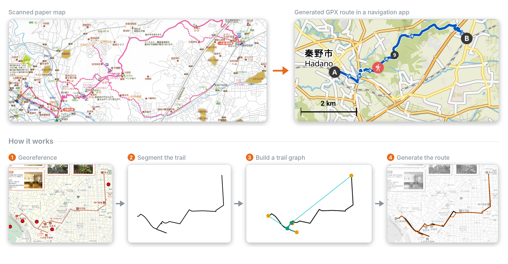

# RouteExtract

**Turn scanned hiking and sightseeing maps into GPS routes you can follow.**

[[Paper (arXiv)](https://arxiv.org/abs/2509.11674)] · GDUG Workshop at ICCV 2025


<sub>Maps: top, Hadano City, *Hiking Map, Course B* (ハイキングマップBコース,
[source](https://www.city.hadano.kanagawa.jp/material/files/group/51/B.pdf)), © Hadano City;
bottom, Taito City, *Shitaya Shichifukujin* (下谷七福神,
[source](https://t-navi.city.taito.lg.jp/storage/pamphlet_pdf/20250321085114_shitaya_shichifukujin_2503.pdf)), © Taito City.
Navigation app: Komoot, map data © OpenStreetMap contributors.</sub>

Paper maps from tourist offices and municipalities often show trails that are hard to find in digital map apps.
RouteExtract is a modular pipeline that extracts these trails and makes them routable:

1. **Georeferencing**: align the scanned map with real-world coordinates using ground control points.
2. **Trail segmentation**: a neural network extracts the trail from the map image.
3. **Route generation**: the extracted trail is converted into a graph and matched to OpenStreetMap paths with
   GraphHopper, producing a GPX track.

We also release a **dataset of 50 annotated maps from Japan** with 86 hand-made trail masks and ground control points
(see [Map Dataset](#map-dataset)).

## Setup

### Requirements
For the required python packages, simply install them from the provided `requirements.txt` file with pip or uv. Our own
environment is a conda environment with python 3.12.11, but other environments and python versions may work, too.
```shell
pip install uv && \
uv pip install -r requirements.txt
```

For route generation, an instance of GraphHopper with map data is also required, see the section *GraphHopper*.

### GraphHopper
GraphHopper is used to calculate routes. It's open source and uses OpenStreetMap data: by hosting it yourself, it is 
completely free to use. All you need to get started is a recent graphhopper.jar file, a correspondingly recent JDK and some
OSM data.

```shell
cd GraphHopper && \
wget https://repo1.maven.org/maven2/com/graphhopper/graphhopper-web/10.2/graphhopper-web-10.2.jar
```
GraphHopper/run_instructions.txt contains information on how to get the GraphHopper server running if following the same
directory structure as outlined in that file.

### OpenStreetMap (OSM) Data
The snapshots used for this project were obtained on https://download.openstreetmap.fr/ which hosts daily snapshots of
different regions and countries. However, OSM Data can be obtained in various ways and should be compatible with GraphHopper
in any of the commonly available file formats.

Example on how to get OSM data:
```shell
mkdir GraphHopper/Kanto; \
mkdir GraphHopper/Kanto/Pedestrian; \
cd GraphHopper/Kanto/Pedestrian && \
wget 'https://download.openstreetmap.fr/extracts/asia/japan/kanto.osm.pbf'; \
cp ../../config-example.yml config.yml;
cd ../../../
```

When running GraphHopper for the first time with a specific configuration and OSM file, it will take some minutes to set
everything up. Consequent startups will be much faster!

### Map Dataset
We provide the scripts to generate our map dataset within this directory. The dataset contains 50 hiking and sightseeing
maps from around Japan. Each map has manually created masks for every trail in a map. We also provide Ground Control Points
for georeferencing the maps.
Note that we don't host the maps ourselves but only provide links to publicly accessible maps. Please let us know if any
of the provided download links don't work anymore!

`download_maps.py` verifies every file against a SHA-256 hash. If a download fails, simply run the script again: files
that already exist and match their hash are skipped. Some publishers have since moved or re-released their maps, so a few
sources differ from the versions used in the paper:
- `map012`: the original pamphlet was replaced by a 2026 edition. The trails and the base map are unchanged and the masks
  still align, but some illustrations around the trails differ, so results on this map will not exactly match the paper.
- `map015`, `map019`: the files were re-published and have new hashes, but they render (nearly) identically to the
  originals at the resolution we use.

Here's how to download and prepare the dataset:
```shell
cd dataset/ && \
python download_maps.py && \
python convert_pdf_to_image.py && \
python crop_and_resize.py && \
cd ../
```

#### Georeferencing and trail start/end points
Since v1.1, every map in `dataset/maps_manifest.yaml` has Ground Control Points (`gcps`), and every trail has a start
and end point (`start`, `end`, given as `[lat, lon]`), so any train/val/test split can be evaluated. In v1.0, these
were only complete for the maps of the test split used in the paper. Two fields describe the GCPs of each map:
- `gcp_source`: `manual` for the 21 maps georeferenced by hand for the paper, `semi_automatic` for the 29 maps
  added in v1.1. For those, tie points between named map features and OpenStreetMap were refined against OSM
  geometry (water bodies, coastlines or street networks) or, for illustrated maps, fitted directly.
- `gcp_quality: approximate`: set for maps that are not drawn to scale (`map018`, `map027a`, `map027b`, `map030a`),
  where an affine transform only roughly fits the drawing (errors of about 50–150 m). `src/batch_evaluate_gpx.py`
  skips these maps by default (`SKIP_APPROXIMATE_GCPS`).

The GCPs of `map003b` were replaced in v1.1 by a better-spread set (11 instead of 3 points). This map is part of the
training split in the paper, so the reported results are not affected.

## How to run
### Trail Segmentation
Before training the segmentation model, you first need to run `src/trail_dataset.py` once to generate the `split.txt` file
which assigns each map and trail to train, val, or test split.
To train the segmentation, run `src/train_trail_segmentation.py`. The model can be evaluated with `src/evaluate_trail_segmentation.py`.

### Route Generation
Routes can be generated using either `src/generate_gpx.py` or `src/batch_generate_gpx.py`.
Similarly, evaluation can be done using `src/evaluate_gpx.py` or `src/batch_evaluate_gpx.py`.

## Citation
If you use RouteExtract or our dataset, please cite:
```bibtex
@misc{kremser2025routeextract,
  title         = {RouteExtract: A Modular Pipeline for Extracting Routes from Paper Maps},
  author        = {Kremser, Bjoern and Matsui, Yusuke},
  year          = {2025},
  eprint        = {2509.11674},
  archivePrefix = {arXiv},
  note          = {GDUG Workshop at ICCV 2025}
}
```

## Map sources
The maps are not part of this repository and remain the property of their publishers; `dataset/resources.json` lists
the source of every map.
